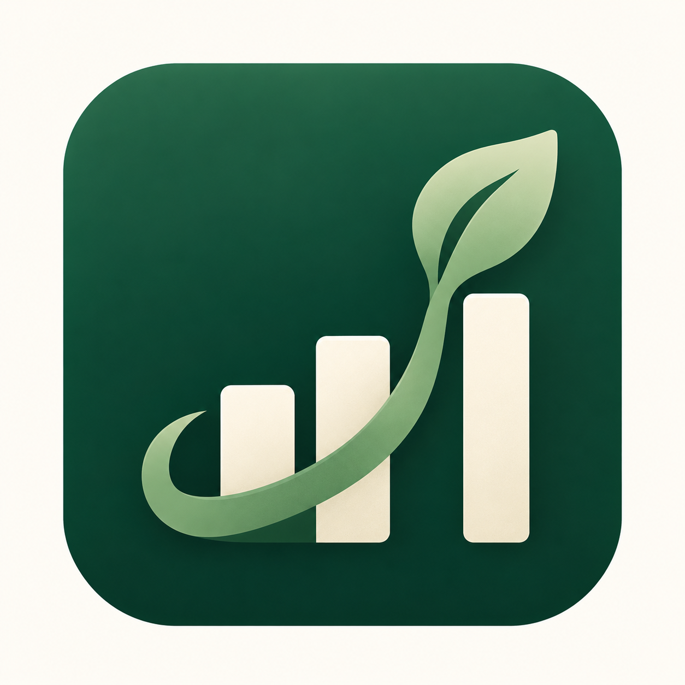

<p align="center">
  
</p>

<h1 align="center">FolioBuddy</h1>
<p align="center"><b>See what your ETFs really own.</b></p>

---

## Table of contents

1. [What is FolioBuddy?](#1-what-is-foliobuddy)
2. [The problem it solves](#2-the-problem-it-solves)
3. [Who it is for](#3-who-it-is-for)
4. [Key terms in plain English](#4-key-terms-in-plain-english)
5. [How it works: the four steps](#5-how-it-works-the-four-steps)
6. [A worked example](#6-a-worked-example)
7. [What FolioBuddy does not do](#7-what-foliobuddy-does-not-do)
8. [Where the data comes from](#8-where-the-data-comes-from)
9. [Supported funds and stocks](#9-supported-funds-and-stocks)
10. [Limitations of this prototype](#10-limitations-of-this-prototype)
11. [Possible future improvements](#11-possible-future-improvements)
12. [Frequently asked questions](#12-frequently-asked-questions)
13. [For developers: running the app](#13-for-developers-running-the-app)

---

## 1. What is FolioBuddy?

FolioBuddy is a free website that helps everyday investors understand what is
**inside** their investments.

Many people buy ETFs because they want an easy way to spread their money across
many companies. Each ETF is a basket of companies, but the baskets are not
labelled clearly, and different ETFs often contain **the same companies**.
FolioBuddy opens up every basket, adds everything together, and shows you in
simple charts:

- which companies your money is **actually** invested in,
- which industries (sectors) you lean towards,
- whether your investments tend to **rise and fall together**, and
- how things would change if you **moved your money around**.

You type in what you own, and FolioBuddy shows the results. You do not need to
sign up, connect a bank account, or know any finance jargon.

---

## 2. The problem it solves

### "I own four different funds, so I must be well diversified." Not always.

Imagine you own three ETFs with names that sound different:

| What you think you bought | What is actually inside |
| --- | --- |
| An "S&P 500" fund | 500 large US companies, with NVIDIA, Microsoft and Apple at the top |
| A "Total Stock Market" fund | Almost every US company, again with NVIDIA, Microsoft and Apple at the top |
| A "Growth" fund | Fast-growing companies, again led by NVIDIA, Microsoft and Apple |

On paper you own three products. In practice, a large slice of your money in
each one goes to **the same handful of technology companies**. If those
companies have a bad year, all three funds fall at the same time.

This hidden overlap is hard to spot because:

- fund factsheets are long and full of technical language,
- each fund publishes its holdings separately, so you would have to add them
  up yourself, and
- nobody shows you your combined, "whole picture" exposure.

**FolioBuddy does that adding-up for you, instantly.**

---

## 3. Who it is for

- **Beginner and casual investors** who buy ETFs through apps and want to know
  what they really own.
- **People who already own several funds** and suspect they are overlapping.
- **Students and learners** who want a visual way to understand
  diversification.
- **Anyone deciding where to put new money** who wants to see how one more fund
  would change their overall mix.

---

## 4. Key terms in plain English

| Term | What it means |
| --- | --- |
| **Stock** (or share) | A small piece of ownership in a single company, such as Apple. |
| **ETF** (Exchange-Traded Fund) | A ready-made basket of many stocks that you can buy in one go, like buying a fruit basket instead of individual apples and oranges. |
| **Ticker** | The short code used to identify a stock or fund on the market, such as `AAPL` for Apple or `SPY` for an S&P 500 fund. |
| **Portfolio** | Everything you have invested, taken together. |
| **Weight** | The percentage of your portfolio in one thing. If you put \$5,000 of \$10,000 into one fund, its weight is 50%. |
| **Look-through** | Opening up each ETF to see the individual companies inside and adding them up across all your funds. |
| **Exposure** | How much of your total money ends up in a particular company or industry, directly or through funds. |
| **Overlap** | The same company appearing in more than one of your investments. |
| **Sector** | A group of companies in the same type of business, such as Technology, Healthcare or Energy. |
| **Diversification** | Spreading your money across different things so that one bad event does not hurt everything at once. |
| **Correlation** | A score from -1 to +1 describing whether two investments tend to move up and down together. Near **+1** means they move together; near **0** means no clear link; below 0 means they tend to move in opposite directions. |
| **Rebalancing** | Changing how much money you put in each investment to get a different mix. |

---

## 5. How it works: the four steps

FolioBuddy guides you through four steps, shown as tabs across the top of the
page. You can click any tab to jump between them at any time.

### Step 1: Portfolio — "What do you hold?"

You list what you own:

1. Type the **ticker** of each ETF or stock. A drop-down list suggests the
   supported names as you type.
2. Enter the **amount** you have invested in it (for example, 5000).
3. FolioBuddy automatically works out each holding's **weight** (its share of
   your total).

You can add as many rows as you like with **"+ Add holding"**, and delete a row
with the **✕** button. If you type a ticker FolioBuddy does not recognise, it
tells you and still includes it, treating it as a single company.

When you are ready, click **"Look through →"**.

### Step 2: Exposure — "What do I really own?"

This is the heart of FolioBuddy. It shows:

- **Three headline numbers:**
  - the **single company** you are most exposed to, and what percentage of your
    whole portfolio it represents,
  - how much of your money sits in your **top 5 companies combined**, and
  - how many companies you hold **through two or more** of your investments
    (your overlap).
- **"Your real company exposure"** is a ranked list of companies with a bar for
  each one. The bar is **colour-coded by where the exposure comes from**, so
  you can see, for example, that your Apple exposure comes partly from one fund
  and partly from another. The top 12 are shown first, and you can expand the
  list to see all of them.
- **"Sector allocation"** is a chart showing how your money is split across
  industries such as Technology, Financials and Healthcare.

### Step 3: Correlation — "Do my holdings move together?"

This step shows a **colour-coded grid** comparing every pair of your
investments:

- Each square holds a correlation score between -1 and +1.
- **Darker colour means a stronger relationship.**
- FolioBuddy points out your **most similar pair**. If their score is above
  0.8, it warns that "historically they behave almost like the same
  investment", a sign that owning both may add less diversification than you
  expected.

### Step 4: Simulate — "What if I rebalanced?"

This step is a safe sandbox for trying ideas:

- Drag a **slider** for each holding to change how much of your money it gets.
  The percentages always add up to 100%.
- Use **"+ Try adding an ETF…"** to test a fund you do not own yet.
- Two side-by-side charts compare **Current** and **Simulated** results for
  your top companies and your sectors, so you can see the effect immediately.

Nothing is bought or sold. FolioBuddy only recalculates the numbers.

---

## 6. A worked example

When you first open FolioBuddy, it loads an example portfolio worth
**\$11,000**:

| Holding | Amount | Weight |
| --- | --- | --- |
| SPY (S&P 500 fund) | \$5,000 | 45.5% |
| QQQ (Nasdaq-100 fund) | \$3,000 | 27.3% |
| VTI (Total Stock Market fund) | \$2,000 | 18.2% |
| NVDA (NVIDIA stock) | \$1,000 | 9.1% |

**How FolioBuddy calculates your NVIDIA exposure:**

- SPY puts about **7%** of its money into NVIDIA. You have 45.5% of your
  portfolio in SPY, so: 45.5% × 7% ≈ **3.2%**.
- QQQ puts about **9.5%** of its money into NVIDIA. You have 27.3% in QQQ, so:
  27.3% × 9.5% ≈ **2.6%**.
- VTI puts about **6.2%** of its money into NVIDIA. You have 18.2% in VTI, so:
  18.2% × 6.2% ≈ **1.1%**.
- You also own NVIDIA **directly**: **9.1%**.
- **Total NVIDIA exposure ≈ 16.0%** of your entire portfolio.

So although NVIDIA is "only" one of your four rows, about one-sixth of your
money depends on that single company. FolioBuddy shows this in one bar, split
into colours for SPY, QQQ, VTI and your direct NVIDIA shares.

---

## 7. What FolioBuddy does not do

To be clear about its role:

- **It is not financial advice.** It shows information to help you understand
  your portfolio. It does not tell you what to buy or sell.
- **It does not trade.** It never connects to a broker and cannot move your
  money.
- **It does not store your data.** Everything you type stays in your own
  browser. Nothing is sent to a server or saved to an account, and refreshing
  the page starts over.
- **It does not predict the future.** Correlation describes past behaviour
  only.

---

## 8. Where the data comes from

FolioBuddy is a **prototype**, so it uses a built-in sample dataset (dated
**30 September 2026**) instead of a live market feed:

- **Fund contents:** for each supported ETF, FolioBuddy stores its **largest
  holdings** and their approximate percentages. The rest of the fund (the many
  smaller companies) is grouped together and spread across sectors using the
  fund's overall sector split.
- **Company information:** each supported stock has a name and a sector.
- **Price movements for correlation:** the correlation step uses
  **simulated** daily returns over one trading year (252 days), generated to
  behave realistically (for example, tech funds move more like other tech
  funds). The same inputs always give the same results. A full version would
  use real historical prices.

---

## 9. Supported funds and stocks

### ETFs (25 funds)

| Type | Funds |
| --- | --- |
| **Broad US market** | SPY, VOO, IVV (S&P 500) · QQQ (Nasdaq-100) · VTI (Total Stock Market) · DIA (Dow Jones) |
| **Smaller companies** | IWM (Russell 2000) · IJH (Mid-Cap) · IJR (Small-Cap) |
| **Investment style** | VUG (Growth) · VTV (Value) · VYM (High Dividend) · SCHD (Dividend Equity) |
| **Single industry** | XLK (Technology) · SMH (Semiconductors) · XLF (Financials) · XLE (Energy) · XLY (Consumer Discretionary) · XLP (Consumer Staples) · XLI (Industrials) · XLU (Utilities) · XLB (Materials) · XLC (Communication) · XLV (Health Care) · VNQ (Real Estate) |

### Individual stocks (112 companies)

Over a hundred large US-listed companies across all major sectors, including
Apple, Microsoft, NVIDIA, Amazon, Alphabet (Google), Meta, Tesla, JPMorgan,
Visa, Eli Lilly, Exxon Mobil, Coca-Cola, Walmart and more. The full list is
shown at the bottom of the app.

Any ticker outside these lists can still be typed in. It is counted as a
single holding with an "Unclassified" sector.

---

## 10. Limitations of this prototype

- Fund holdings are **approximate** and only the top holdings are listed
  individually.
- Data is a **fixed snapshot** and does not update with the market.
- Correlations use **simulated**, not real, price history.
- Coverage is limited to **US-listed** ETFs and stocks in the sample dataset.
- Your portfolio is **not saved** between visits.

---

## 11. Possible future improvements

- Connect to live market data for up-to-date fund holdings and prices.
- Use real historical prices for the correlation analysis.
- Support more funds, including international and bond ETFs.
- Let users save portfolios or import them from a brokerage statement.
- Add simple, plain-language tips, such as "You hold three funds that are 90%
  similar".

---

## 12. Frequently asked questions

**Do I need to create an account?**
No. Open the website and start typing.

**Is my information safe?**
Yes. Nothing you enter leaves your browser, and nothing is stored.

**Why does a company show up with several colours in its bar?**
Because you own it through more than one investment. Each colour represents one
of your holdings, which shows where your overlap comes from.

**What does a correlation of 0.95 mean?**
Those two investments have historically moved almost in lockstep. Owning both
gives you very little extra protection compared with owning just one.

**I typed a ticker and it says "Not in dataset". Is that a problem?**
No. FolioBuddy still includes it as a single company. It just cannot look
inside it or tell you its sector.

**Can FolioBuddy tell me what to invest in?**
No. It is an educational tool that helps you understand what you already own.

---

## 13. For developers: running the app

FolioBuddy is a web app built with **React**, **TypeScript**, **TanStack
Start**, **Tailwind CSS** and **Recharts**. All calculations run directly in
the browser, with no separate backend.

**Requirements:** [Node.js](https://nodejs.org/) (version 20 or newer) and npm.

```sh
git clone https://github.com/coweeoh/foliobuddy.git
cd foliobuddy
npm install
npm run dev
```

Then open the address shown in the terminal (usually `http://localhost:8080`
or `http://localhost:5173`) in your browser.

| Command | What it does |
| --- | --- |
| `npm run dev` | Starts the app locally for development |
| `npm run build` | Builds the production version |
| `npm test` | Runs the automated tests |
| `npm run lint` | Checks the code for common problems |

**Where things live:**

| Path | Contents |
| --- | --- |
| `src/routes/index.tsx` | The main page and all four steps |
| `src/lib/folio/data.ts` | Sample dataset of funds, stocks and sectors |
| `src/lib/folio/engine.ts` | Calculations for weights, look-through and correlation |
| `src/lib/folio/engine.test.ts` | Tests for the calculations |

This project was originally scaffolded with [Lovable](https://lovable.dev).

---

<p align="center"><i>FolioBuddy provides information only. It is not investment advice and does not execute trades.</i></p>
